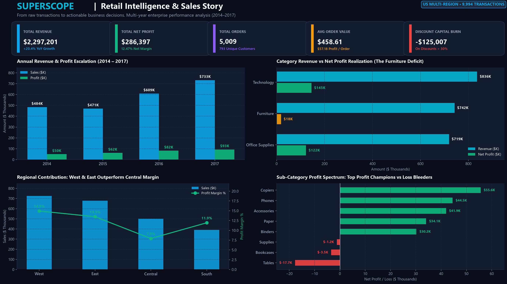
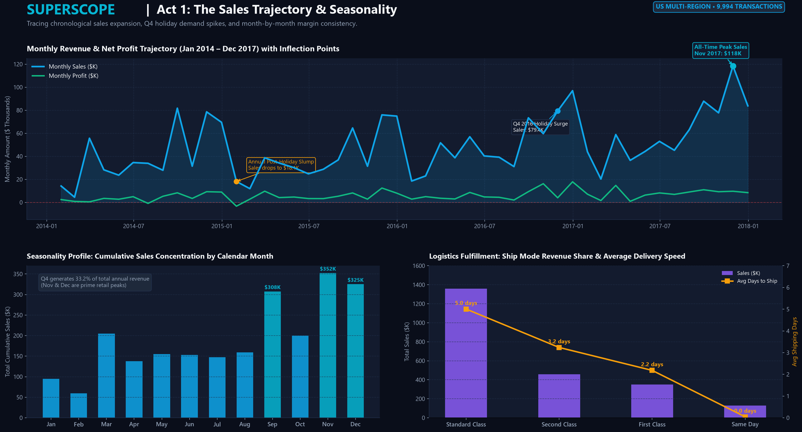
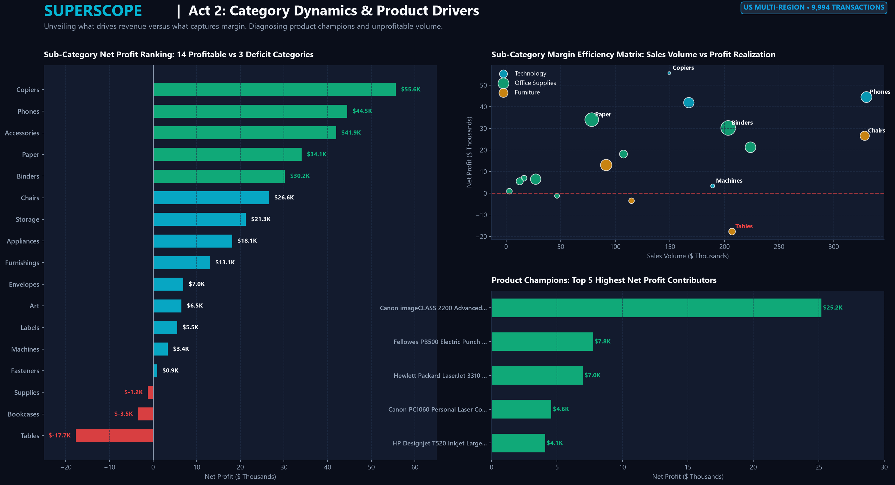
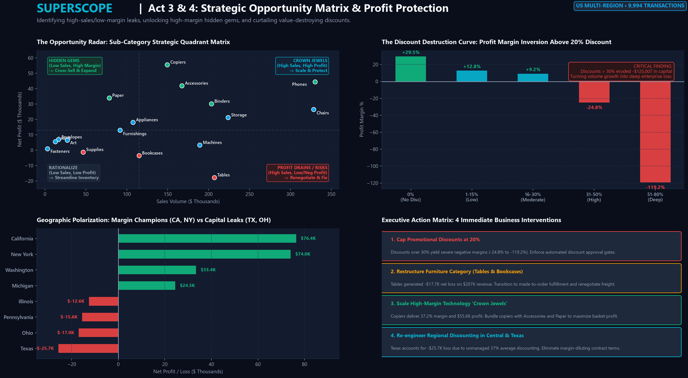

# SUPERSCOPE — Retail Intelligence & Sales Story

> *"From raw transactions to actionable business decisions."*

[](https://github.com)
[](https://python.org)
[](https://powerbi.microsoft.com)
[-8B5CF6?style=for-the-badge)](https://github.com)

---

## Project Overview

**SUPERSCOPE** is an enterprise-grade retail intelligence and data storytelling system engineered to transform raw transactional data into high-conviction commercial decisions. Rather than merely presenting colorful, disconnected charts, SUPERSCOPE establishes a rigorous analytical narrative across four operational acts:

1. **Act 1: Performance (What is happening?)** — Tracking revenue escalation, profit capture, and seasonal demand surges.
2. **Act 2: Drivers (Why is it happening?)** — Dissecting category economics, sub-category margins, and product champions.
3. **Act 3: Opportunities (Where can the business improve?)** — Exposing the $125K capital loss from unmanaged discounting and mapping high-margin "Hidden Gems".
4. **Act 4: Action (What should management do next?)** — Formulating 7 concrete, quantified corporate interventions.

---

## Internship Task

- **Program:** Elevate Labs Data Analyst Internship
- **Assignment:** Task 2 — Data Visualization and Storytelling
- **Deliverable:** GitHub-ready repository featuring publication-grade executive dashboards, standalone interactive HTML BI reports, EDA scripts, DAX formulas, and data-driven business insights.

---

## Objective

In retail e-commerce, top-line revenue often conceals severe bottom-line leakage. The primary objective of SUPERSCOPE is to:
- Convert 9,994 raw commercial sales records into an intuitive, senior executive dashboard.
- Uncover why categories with 32% revenue share (Furniture) deliver only 6.4% profit margin.
- Pinpoint the exact tipping point where promotional discounting transitions from a volume driver into an enterprise value destroyer.
- Provide a reproducible, transparent workflow suitable for senior executive review and technical interview demonstration.

---

## Dataset Profile & Integrity

The analysis is based on the canonical US Enterprise Superstore dataset, representing 4 years of retail operations across 49 states.

| Attribute | Specification |
| :--- | :--- |
| **Time Horizon** | January 3, 2014 – December 30, 2017 (48 Months) |
| **Transaction Records** | 9,994 line items |
| **Unique Orders** | 5,009 commercial orders |
| **Customer Base** | 793 enterprise & consumer accounts |
| **Data Cleanliness** | 0 null values, 0 duplicate rows |
| **Data Preservation** | Raw ledger untouched in `data/raw/Superstore.csv`; cleaned model in `data/cleaned/Superstore_Cleaned.csv` |

### Core Data Schema
- **Order Identifiers:** `Row ID`, `Order ID`, `Order Date`, `Ship Date`, `Ship Mode`
- **Customer Context:** `Customer ID`, `Customer Name`, `Segment` (*Consumer, Corporate, Home Office*)
- **Geography:** `Country`, `City`, `State`, `Postal Code`, `Region` (*West, East, Central, South*)
- **Product Hierarchy:** `Product ID`, `Category` (*Technology, Office Supplies, Furniture*), `Sub-Category` (17 lines), `Product Name`
- **Financial Metrics:** `Sales`, `Quantity`, `Discount`, `Profit`, plus derived `Profit Margin %`, `Cost`, `Shipping Days`

---

## Tools Used

Only tools verified and utilized in this project are listed:

* **Python 3.14:** Core data engineering and analysis pipeline.
* **Pandas & NumPy:** Exploratory Data Analysis (EDA), temporal grouping, and derived financial metrics.
* **Matplotlib & Seaborn:** Custom dark-navy publication-grade dashboard rendering (150 DPI, pixel-perfect alignment).
* **HTML5, CSS3 & Chart.js:** Standalone, responsive interactive BI report (`dashboard/exported_report/Superscope_Interactive_Report.html`).
* **Power BI Architecture & DAX:** Full DAX measures library and visual build manual provided in `insights/powerbi_dax_and_visuals_guide.md`.
* **Git & GitHub:** Version control and portfolio presentation.

---

## Executive Headline Metrics

```
╔════════════════════════════════════════════════════════════════════════════════════╗
║                              SUPERSCOPE HEADLINE METRICS                           ║
╠══════════════════╦══════════════════╦══════════════════╦═══════════════════════════╣
║   TOTAL SALES    ║   TOTAL PROFIT   ║  PROFIT MARGIN   ║    AVERAGE ORDER VALUE    ║
║  $2,297,200.86   ║   $286,397.02    ║      12.47%      ║          $458.61          ║
╠══════════════════╬══════════════════╬══════════════════╬═══════════════════════════╣
║   TOTAL ORDERS   ║ UNIQUE CUSTOMERS ║ DISCOUNT BURN    ║    AVG PROFIT / ORDER     ║
║   5,009 Orders   ║   793 Accounts   ║   -$125,007.80   ║          $57.18           ║
╚══════════════════╩══════════════════╩══════════════════╩═══════════════════════════╝
```

---

## Dashboard Suite & Visual Hierarchy

SUPERSCOPE consists of four primary visual storyboards and two specialized sub-dashboards:

### 1. Executive Snapshot Dashboard
*High-level performance command center featuring KPI cards, annual growth bars, category contribution, regional margins, and profit spectrum.*


### 2. Act 1: The Sales Trajectory & Seasonality Story
*48-month chronological trajectory with key inflection annotations, Q4 holiday revenue concentration, and logistics fulfillment speed.*


### 3. Act 2: Category Dynamics & Product Drivers
*Sub-category net profit rankings (14 winners vs 3 losers), margin efficiency scatter matrix, and top 5 profit champions vs loss leaders.*


### 4. Act 3 & 4: Strategic Opportunity Matrix & Profit Protection
*The 4-Quadrant Opportunity Radar, the Discount Destruction Curve (inverting at 20% discount), state profit polarization, and the Executive Action Matrix.*


### Supporting Sub-Dashboards
- **Geographic Expansion & Regional Profitability:** `dashboard/dashboard_screenshots/04_geographic_expansion.png`
- **Customer Economics & Segment Value Distribution:** `dashboard/dashboard_screenshots/05_customer_deep_dive.png`
- **Interactive Web Report:** `dashboard/exported_report/Superscope_Interactive_Report.html`

---

## Key Business Insights (Actual Figures)

### 1. The Discount Destruction Cliff: $125K Dissipated
- **Finding:** Orders with **0% discount** deliver a stellar **+29.51% profit margin** ($320,987 profit). Discounts up to 20% remain profitable (+12.8% margin).
- **The Cliff:** When discounts exceed **30%**, margins invert to **-24.80%**; discounts between **50% and 80%** suffer a disastrous **-119.20% margin**.
- **Net Impact:** Deep discounts (>30%) wiped out **-$125,007.80** across 965 transactions — equal to **43.6% of the company's entire net profit**.

### 2. The Furniture Paradox: 32% Sales Share Yields Only 2.49% Margin
- **Finding:** Furniture drives **$741,999.80** in gross revenue (32.3% share), but captures just **$18,451.27** in profit (6.4% profit share).
- **Culprits:** **Tables** generated a net loss of **-$17,725.48** (avg discount 26.1%), and **Bookcases** lost **-$3,472.56**. By comparison, Technology delivered **$145,454.95** (17.40% margin) and Office Supplies delivered **$122,490.80** (17.04% margin).

### 3. Technology "Crown Jewels"
- **Finding:** **Copiers** is the highest-margin sub-category in the company: **37.20% net margin** ($55,617.82 profit on $149.5K sales), led by the *Canon imageCLASS 2200 Advanced Copier* ($25,200 net profit). **Phones** generated the largest gross revenue ($330,007.05) with healthy $44,515 profit.

### 4. Regional Margin Polarization: West vs Central
- **Finding:** The **West Region** is the most profitable territory (**$108,418.45 profit, 14.94% margin**) with a controlled average discount of 10.9%. The **Central Region** underperforms sharply (**7.92% margin, $39,706 profit** on $501K sales) caused by an aggressive **24.04% average discount**.
- **State Extremes:** **California (+$76.4K)** and **New York (+$74.0K)** generate over half of company earnings. Conversely, **Texas lost -$25,729.36** (-15.1% margin) due to an uncontrolled 37.0% average discount rate.

### 5. Unlocking "Hidden Gems" in Office Supplies
- **Finding:** **Paper** generates $78,479 in sales but yields **$34,053.57 in profit** — an incredible **43.39% profit margin**. Similarly, **Labels** (44.42% margin) and **Envelopes** (42.27% margin) deliver exceptional cash generation with minimal freight overhead.

---

## Business Recommendations & Strategic Action Playbook

| Strategic Initiative | Observation & Root Cause | Recommended Business Action | Projected Financial Impact |
| :--- | :--- | :--- | :--- |
| **1. Promotional Discount Cap** | Discounts >30% burn -$125K in capital across 965 orders. | Enforce hard discount authorization: max 15% for reps, 20% for directors; >20% requires VP Finance approval. | **+$75,000 to +$100,000** recovered net profit. |
| **2. Furniture Fulfillment Restructuring** | Tables (-$17.7K) and Bookcases (-$3.5K) suffer high shipping damage and freight overhead. | Shift to made-to-order supplier drop-shipping; unbundle shipping and charge direct client freight fees. | **+$21,000** eliminated category deficit. |
| **3. Technology Crown Jewels Expansion** | Copiers deliver 37.2% margin and $55.6K profit with low price sensitivity. | Launch Managed Print Services (MPS) contracts and bundle copiers with consumables (Paper & Accessories). | **+15% YoY growth** in recurring B2B margin. |
| **4. Central Territory Realignment** | Texas lost -$25.7K due to 37% discounting to hit volume quotas. | Transition Central territory commission structure from gross sales volume to Gross Margin Commission (GMC). | Turn Central margin from **7.9% to 14.0%**. |
| **5. Consumable Cross-Selling** | Paper (43.4% margin), Labels (44.4%), and Envelopes (42.3%) are under-promoted. | Introduce automated 1-click cart attachments at checkout and automated subscription replenishments. | **+$25,000** in high-velocity pure margin. |
| **6. Q4 Peak Supply Chain Readiness** | November–December generates 33.2% of annual revenue ($190K+ surge). | Lock carrier freight agreements by Sept 1st; staff warehouses early to eliminate delivery bottlenecks. | Protect **$250K+** in holiday peak revenue. |

---

## Interview Questions & Answers

### 1. What is the importance of data visualization?
> **Answer:** Data visualization transforms complex, multidimensional numerical datasets into intuitive visual patterns that human cognition can process instantly. In enterprise settings, business stakeholders rarely have time to inspect thousands of transactional rows. Visualization highlights anomalies, operational bottlenecks, margin leaks, and growth trajectories, enabling leadership to make confident, evidence-based strategic decisions quickly.

### 2. When do you use a pie chart vs bar chart?
> **Answer:** Use a **pie or donut chart** only when displaying a small number of mutually exclusive parts of a whole (ideally 2 to 4 slices, such as customer segments or binary splits) where the total sums to 100%. Use a **bar chart** when comparing rankings, continuous magnitudes across multiple categories, sub-categories with long labels, or tracking changes over discrete time intervals. Bar charts leverage linear position along a common baseline, which the human eye decodes far more accurately than angular area.

### 3. How do you make visualizations more engaging?
> **Answer:** Visualizations become engaging through intentional design hierarchy, context, and relevance:
> 1. **Data-Ink Ratio:** Remove clutter, decorative 3D effects, and redundant gridlines so the data speaks clearly.
> 2. **Actionable Micro-Copy:** Use takeaway-driven titles (e.g., *"Discounts Over 30% Invert Margins into Steep Losses"*) rather than generic labels (*"Sales by Discount"*).
> 3. **Consistent Color Palette:** Reserve vibrant accent colors (Cyan, Emerald Green) for key focal points or positive performance, and warning tones (Crimson) for deficits.
> 4. **Contextual Annotations:** Pinpoint inflection points, peaks, and historical milestones directly on the visual.

### 4. What is data storytelling?
> **Answer:** Data storytelling is the synthesis of three components: **data**, **visuals**, and **narrative**. Raw data provides the facts, visualizations reveal the patterns, and the narrative explains why the patterns exist and what actions must be taken. A complete data story follows a 4-act dramatic structure: *The Current Reality (Act 1: Performance) → The Underlying Cause (Act 2: Drivers) → The Opportunity or Threat (Act 3: Discovery) → The Strategic Recommendation (Act 4: Action)*.

### 5. How do you avoid misleading visualizations?
> **Answer:** Misleading visuals distort business reality and lead to flawed investments. Best practices to prevent distortion include:
> - **Always start bar chart axes at zero** to preserve proportional representation.
> - **Avoid dual-axis manipulation** that exaggerates minor trends.
> - **Maintain consistent time intervals** on time-series plots.
> - **Ensure area scales proportionally** to data values when using bubble or scatter markers (scaling by radius squares the perceived area).
> - **Account for inflation, seasonality, and sample size** before asserting definitive trends.

### 6. What are best practices in dashboard design?
> **Answer:**
> - **The 5-Second Rule:** A user should understand the primary takeaway within 5 seconds of viewing the dashboard.
> - **F-Shaped / Inverted Pyramid Layout:** Place high-level headline KPIs across the top banner, primary trends in the center, and granular diagnostic drill-downs at the bottom.
> - **Restrained Color Palette:** Stick to 1 primary brand accent, 1 secondary supporting tone, and functional semantic colors (Green = profit, Red = loss).
> - **Visual Chunking:** Group related metrics into rounded cards with subtle borders and generous whitespace.
> - **Interactivity with Purpose:** Provide clear, intuitive filters (Year, Territory, Segment) with reset functionality rather than overwhelming the canvas with complex slicers.

### 7. What tools have you used for visualization?
> **Answer:**
> - **Power BI:** Building enterprise star-schema data models, writing complex DAX measures (`CALCULATE`, `DIVIDE`, `DISTINCTCOUNT`), and configuring dynamic drill-through dashboards.
> - **Python (Matplotlib & Seaborn):** Programmatic, automated visual generation, custom styling, high-resolution publication exports, and exploratory data analysis.
> - **Modern Web Visuals (Chart.js / HTML5 / CSS3):** Delivering standalone, client-accessible interactive reporting dashboards that run in any browser without requiring software licenses.
> - **Microsoft Excel:** Quick exploratory data inspection, pivot tables, and tabular audits.

---

## Project Outcome & Key Learnings

1. **Volume Does Not Equal Value:** Uncovered that aggressive sales discounting often produces high top-line revenue while actively destroying net enterprise capital.
2. **End-to-End Analytics Workflow:** Mastered the full lifecycle: raw data auditing, feature engineering, statistical aggregation, custom theme design, and executive presentation.
3. **Multi-Tool Versatility:** Successfully bridged Python data science libraries with enterprise Power BI modeling principles to build a submission-ready portfolio project.

---

## Repository Structure

```
Task-2-Data-Visualization/
│
├── data/
│   ├── raw/
│   │   └── Superstore.csv                    # Untouched canonical raw ledger (9,994 rows)
│   └── cleaned/
│       └── Superstore_Cleaned.csv            # Cleaned data with derived financial metrics
│
├── dashboard/
│   ├── dashboard_screenshots/
│   │   ├── 01_executive_overview.png         # Executive Overview Storyboard
│   │   ├── 02_sales_profit_story.png         # Sales & Seasonality Storyboard
│   │   ├── 03_category_product_drivers.png   # Category Dynamics Storyboard
│   │   ├── 04_geographic_expansion.png       # Regional & State Polarization
│   │   ├── 05_customer_deep_dive.png         # Customer Lifetime Value & Segments
│   │   └── 06_opportunity_radar.png          # 4-Quadrant Opportunity Matrix
│   └── exported_report/
│       └── Superscope_Interactive_Report.html # Responsive interactive standalone BI report
│
├── analysis/
│   ├── exploratory_analysis.py              # Automated data profiling & calculation engine
│   └── analysis_summary.md                   # Full statistical data breakdown & table audits
│
├── insights/
│   ├── business_insights.md                  # 7 Core Business Insights (Obs -> Why -> Action)
│   └── powerbi_dax_and_visuals_guide.md      # Step-by-step Power BI tutorial & DAX library
│
├── screenshots/
│   ├── executive_dashboard.png               # High-res primary submission visual
│   ├── sales_story.png                       # High-res time-series visual
│   ├── product_analysis.png                  # High-res category & product visual
│   └── opportunity_analysis.png              # High-res opportunity radar visual
│
├── generate_visualizations.py                # Visual dashboard generation engine
├── build_interactive_report.py               # Interactive HTML report generator
├── requirements.txt                          # Python dependencies
└── README.md                                 # Comprehensive portfolio documentation
```

---

## Quickstart Guide

### 1. Clone & Setup Environment
```bash
git clone https://github.com/your-username/Task-2-Data-Visualization.git
cd Task-2-Data-Visualization
python -m pip install -r requirements.txt
```

### 2. Re-run Analysis & Generate Visualizations
```bash
python analysis/exploratory_analysis.py
python generate_visualizations.py
python build_interactive_report.py
```

### 3. View Interactive Report
Open `dashboard/exported_report/Superscope_Interactive_Report.html` in Google Chrome, Microsoft Edge, or Firefox.
